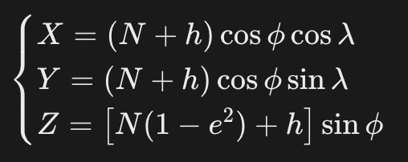

= 经纬度转unity位置
:scripts: cjk
:toc: left
:toclevels: 3
:toc-title: 目录
:numbered:
:sectnums:
:sectnum-depth: 3
:source-highlighter: coderay

== 经纬度
* 纬度: Latitude
* 经度: Longitude
* 大地高(椭球高): Altitude

== LLA坐标系
* L₁ = Latitude → 纬度 φ
* L₂ = Longitude → 经度 λ
* A = Altitude → 大地高 h(**椭球面之上的高度**，不是海拔，WGS84/CGCS2000 里的 h)

== ECEF坐标系
ECEF(Earth-Centered Earth-Fixed)，地心地固坐标系，是**和地球固连、随地球一起自转**的三维直角笛卡尔坐标系，GNSS(GPS / 北斗)底层计算的基础坐标系。

=== 坐标轴定义(右手系)
- 原点: **地球质心**
- X 轴: 赤道面，指向**本初子午线(0° 经线)与赤道交点**
- Y 轴: 赤道面，指向**东经 90° 与赤道交点**
- Z 轴: 指向**协议北极**，和地球平均自转轴重合

=== 坐标形式
**(X, Y, Z)**，单位一般是**米**

=== 和 LLA 的关系

我们平时看到的**纬度 φ、经度 λ、大地高 h(LLA)**是大地坐标，方便人阅读；
而卫星定位内部解算、距离计算，都用 ECEF 直角坐标，二者可以互相转换: 

* N: 卯酉圈曲率半径
* e: 椭球偏心率

== ECI坐标系(顺带了解一下)
ECI(Earth-Centered Inertial)，地心惯性坐标系，原点依然是**地球质心**，但坐标轴**不跟着地球自转**，相对于遥远恒星保持固定(惯性系)。

== WGS84/CGCS2000 坐标系
WGS84 就是最常用的 ECEF 实现(GPS 默认)，北斗也有自己对应的 ECEF 基准(CGCS2000)。

* WGS84椭球常数
+
[source,rust]
----
a  = 6378137.0          // 长半轴 m
f  = 1 / 298.257223563  // 扁率
e² = 2*f - f*f          // 第一偏心率平方
----
* CGCS2000椭球常数
+
[source,rust]
----
a  = 6378137.0 m          // 长半轴
f  = 1.0 / 298.257222101  // 扁率
e² = 0.00669438002290     // 第一偏心率平方
----

== ENU坐标系
属于**局部笛卡尔坐标系**，原点设在**地面上某个参考站点**，不是地心(和 ECEF/ECI 本质区别)

* E = East → 东向
* N = North → 北向
* U = Up → 天向

== Unity中的坐标系
=== 世界坐标系
+X 右，+Y 上，Z 向前

=== 左手判断方法
伸出左手: 拇指 =+X(右)，食指 =+Y(上)，中指 =+Z(前)，三个手指互相垂直

== WGS84转Unity坐标

=== WGS84 -> ECEF

把大地坐标 (φ, λ, h) 转成 ECEF 直角坐标 (X, Y, Z)。

==== 输入输出

* 输入: 纬度 φ、经度 λ(弧度)，大地高 h(米，椭球面之上)
* 输出: ECEF (X, Y, Z)，单位米

==== 椭球常数(WGS84)

* a = 6378137.0 m (长半轴)
* f = 1/298.257223563 (扁率)
* e² = 2f - f² ≈ 0.00669437999014 (第一偏心率平方)

==== 公式

[source,rust]
----
N = a / √(1 - e²·sin²φ)              // 卯酉圈曲率半径

X = (N + h)·cosφ·cosλ
Y = (N + h)·cosφ·sinλ
Z = (N·(1 - e²) + h)·sinφ
----

* φ、λ 输入前要转成弧度(常见源数据是度)
* h 是 WGS84 椭球高，不是海拔高，二者差一个高程异常
* Z 用 N·(1 - e²) 对应短半轴 b = a·(1 - f)

=== ECEF -> ENU

把 ECEF (X, Y, Z) 转成以参考点 (φ₀, λ₀, h₀) 为原点的 ENU 局部坐标 (e, n, u)。

==== 输入输出

* 输入: ECEF (X, Y, Z) + 参考点 (φ₀, λ₀, h₀)
* 输出: ENU (e, n, u)，米，相对参考点的偏移

==== 步骤

. 参考点 (φ₀, λ₀, h₀) 经 WGS84->ECEF 得到 (X₀, Y₀, Z₀)
. 求差: (dx, dy, dz) = (X - X₀, Y - Y₀, Z - Z₀)
. 用旋转矩阵 R 把差值转到 ENU 局部系

==== 旋转矩阵

[source,rust]
----
       [ -sinλ₀        cosλ₀       0      ]
R  =   [ -sinφ₀cosλ₀  -sinφ₀sinλ₀  cosφ₀  ]
       [  cosφ₀cosλ₀   cosφ₀sinλ₀  sinφ₀  ]

e = -sinλ₀·dx + cosλ₀·dy
n = -sinφ₀cosλ₀·dx - sinφ₀sinλ₀·dy + cosφ₀·dz
u =  cosφ₀cosλ₀·dx + cosφ₀sinλ₀·dy + sinφ₀·dz
----

* R 只依赖参考点 (φ₀, λ₀)，与待转换点无关，同场景可预计算一次
* 参考点变了 ENU 结果完全不同，必须先固定原点
* ENU 是右手系，旋转矩阵保持右手性

=== ENU -> Unity

ENU 是右手系局部坐标，Unity 世界坐标系是左手系(+X 右、+Y 上、+Z 前)，二者**不是简单一一对应**，需要做完整的仿射变换:

[source,rust]
----
p_unity = T + S · R · Swizzle(p_enu)
----

四个步骤顺序不能换: **轴重映射 → 缩放 → 旋转 → 平移**。

==== 轴重映射(Swizzle)

ENU 右手系(E×N=U)，Unity 左手系(X×Y=+Z)。把 E→X、U→Y、N→Z 后，Unity 的 X×Y=+Z 对应 E×U=N，而 ENU 里 E×U=-N，恰好翻转一次符号，等于自动完成左右手系切换。

[cols="1,1,1,1", options="header"]
|===
|ENU 轴 |含义 |Unity 轴 |含义

|E |东向 |+X |右
|N |北向 |+Z |前
|U |天向 |+Y |上
|===

NOTE: 这是角色朝北时的默认映射。

==== 缩放(Scale)

* Unity 默认 1 unit = 1 m，和 ENU 米一致，缩放系数 k=1
* 大尺度场景(城市/省份)常用 1 unit = 1 km，则 k = 1/1000
* 小尺度(室内)可能 1 unit = 1 cm，则 k = 100
* 代码里用 `swizzled / MetersPerUnit` 统一换算

==== 旋转(Rotation)

设朝向角 θ = 从北顺时针到角色当前朝向(度)。

* θ=0(朝北): 第 1 步重映射后"北"已对齐 +Z(前)，R = 单位矩阵
* θ=90(朝东): "东"要落到 +Z，绕 Y 轴转 -90°
* 通用: 绕 Y 轴旋转 -θ，用 `Quaternion.Euler(0, -θ, 0)`
* Unity 正向 Y 旋转是从上方看顺时针(+Z→+X→-Z→-X)，所以北→东对应 +90°，要反向抵消故取负

==== 4. 平移(Translation)

* 让 ENU 原点 = Unity 原点 → T = (0,0,0)
* 让 ENU 原点 = Unity 中某锚点物体 → T = 该物体世界坐标
* 平移放最后，针对旋转缩放后的向量做整体偏移

==== 用 Umeyama 自动估计 R, S, T

上面 1-4 步是"参数已知"时的手动做法。如果手里有一组 **ENU 点 ↔ Unity 点** 的对应(N ≥ 3 对不共线)，可以直接用 Umeyama 算法一次解出最优的 (R, s, t)，无需手动指定缩放、朝向、平移。

Umeyama 通过 SVD 分解协方差矩阵，得到最小二乘意义下对齐两组点的相似变换(旋转 + 各向同性缩放 + 平移)，是点云配准、ICP 的标准做法。

===== 步骤

[listing]
....
1) 质心    x̄ = (1/N) Σ x_i,   ȳ = (1/N) Σ y_i
2) 中心化  X = [x_i - x̄],    Y = [y_i - ȳ]
3) 协方差  H = (1/N) · X · Yᵀ  (3×3)
4) SVD     H = U · S · Vᵀ
5) 旋转    d = sign(det(V · Uᵀ))           // 反射校正
           R = V · diag(1, 1, d) · Uᵀ
6) 缩放    σ_x² = (1/N) Σ ||x_i - x̄||²
           s = (S[0] + S[1] + S[2]·d) / σ_x²
7) 平移    t = ȳ - s · R · x̄
....

NOTE: 步骤 5 的 d 是为了防止反射解——当 V·Uᵀ 的 det 为负时，说明最优解含反射，强制 d=-1 把它拉回正常旋转。

===== 代码(伪代码)

[source,csharp]
----
// src: ENU 点集(米)，dst: 对应的 Unity 点集(世界坐标)
// 返回最优 (R, s, t)，使 ||s·R·src + t - dst||² 最小
(Quaternion R, float s, Vector3 t) Estimate(
    List<Vector3> src, List<Vector3> dst)
{
    int n = src.Count;
    var meanSrc = Mean(src); var meanDst = Mean(dst);

    // 协方差 H = (1/N) Σ (x_i - x̄)(y_i - ȳ)ᵀ
    var H = new Matrix3x3();
    double varSrc = 0;
    for (int i = 0; i < n; i++) {
        var dx = src[i] - meanSrc;
        var dy = dst[i] - meanDst;
        varSrc += dx.sqrMagnitude;
        H += Outer(dx, dy);
    }
    varSrc /= n;  // σ_x²
    H /= n;       // 归一化

    // SVD: H = U · S · Vᵀ —— Unity 没原生 3×3 SVD，用 Jacobi 自己实现或引第三方库
    Svd3x3(H, out var U, out var S, out var V);

    // 反射校正 + 旋转
    float d = Mathf.Sign((V * U.Transpose()).Determinant());
    var D = Matrix3x3.Identity; D[2,2] = d;
    var Rmat = V * D * U.Transpose();

    // 缩放 + 平移
    float s = (S[0] + S[1] + S[2] * d) / (float)varSrc;
    Vector3 t = meanDst - s * (Rmat * meanSrc);
    return (ToQuaternion(Rmat), s, t);
}
----

NOTE: Unity 没原生 3×3 SVD，常见做法是用 Jacobi 法自己写(几十行)，或引 Math.NET Numerics / EigenSharp 等库。

===== 和手动法的配合

* ENU 右手系 → Unity 左手系需要一次反射(det=-1)，标准 Umeyama 限制 R ∈ SO(3) 不能给反射解
* 实践做法: **先套用第 1 步的 Swizzle(E→X, U→Y, N→Z)**，把反射固定下来，再用 Umeyama 估计剩下的 (R_yaw, s, t)
* 这样 Umeyama 只需解一个偏航旋转 + 缩放 + 平移，全是正常刚性变换，不会触发反射校正

==== 注意事项

* 大地高 h(椭球高) ≠ 海拔高，接入海拔数据时先做高程异常改正
* ENU 原点经纬度一旦确定，所有 ENU 坐标都是相对该原点的偏移
* Swizzle → Scale → Rotate → Translate 顺序固定，任意调换会出错